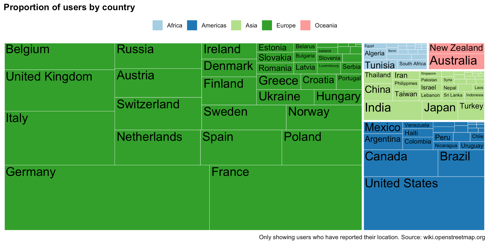
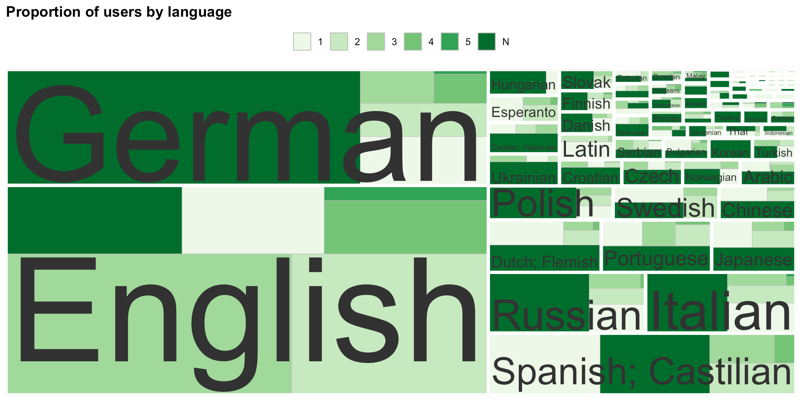

In previous stages of the codesign process with Geochicas, we tried to map actors and projects in OSM. During the meeting we were pointed to interesting resources faced some challenges:

- **Scope:** what kind of projects and actors do we want to include? We know they should be within OSM, but are they to be related to any underrepresented groups or just one category? (gender, ethnicity, sexual orientation…)

- **Population mechanism:** how and who can/should populate the dataset? How to ensure that information is exhaustive, up-to-date? How do we know if something is happening?

In this meeting we took a different path and focused on OSM's demographics. This is not a straighforward task, as there are mutliple issues that need to be addressed:

1.  **Lack of census or statistics:** the only information OSM has about their users are their usernames and emails (plus any links that each user may decide to include on their bios). This is a well-known issue and Geochicas have been long advocating for a demographic census in OSM and have been doing annual surveys to mitigate that, albeit participation tends to be low.
2.  **One person, multiple users:** OSM users multiple platforms besides the one at openstreetmap.org, such as the wiki or community forums. Each platform is independent and requires different logins, meaning that one person may have multiple users, and those usernames do not necessarily match. And what is more, a person may have a profile in one of those platforms only.

To address that, we explored a computational approach consisting of automatically extracting all the structured data that users have self-reported about themselves.

Findings reveal an enormous bias, albeit with some caveats due to lack of representativity of the data.





## Slides

```{=html}
<iframe class="slide-deck" src="/slides/users_stats/index.html"></iframe>
```