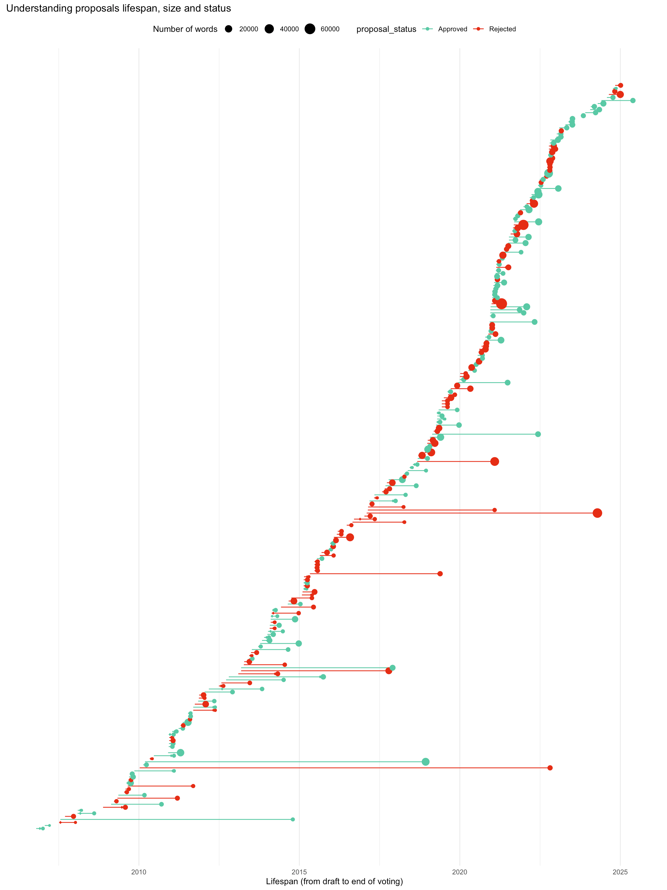

In this meeting it was flagged how besides the most obvious form of contributing to OpenStreetMap by adding and editing map features, OSM offers a number of options, which include documenting on the wiki, discussing in the forum, writing blog posts, joining the OpenStreetMap Foundation... one of the features that has been understudied are tagging proposals.

After a lot of time to get data that we could use, we created a prototype of a visualisation that brings insights about the process:

