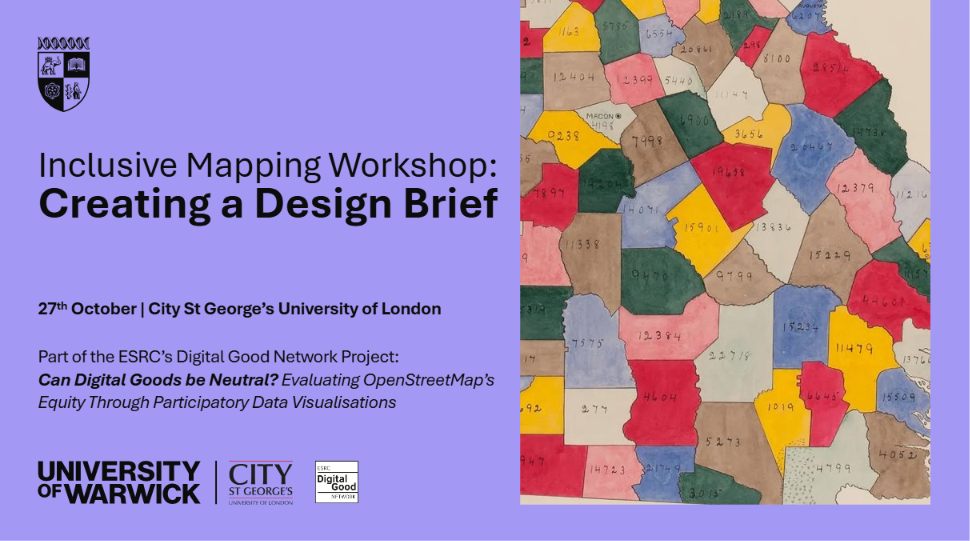
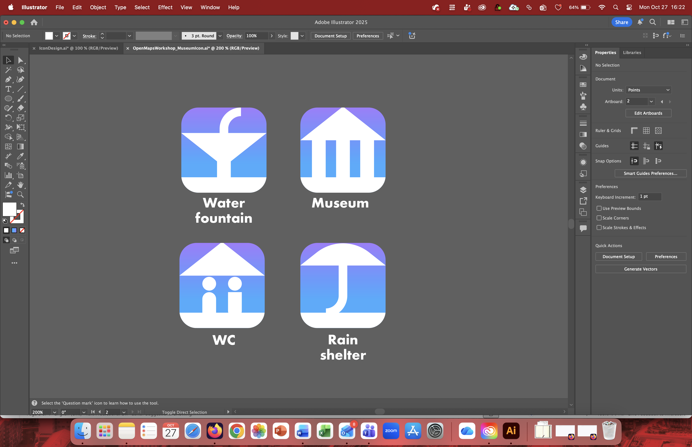
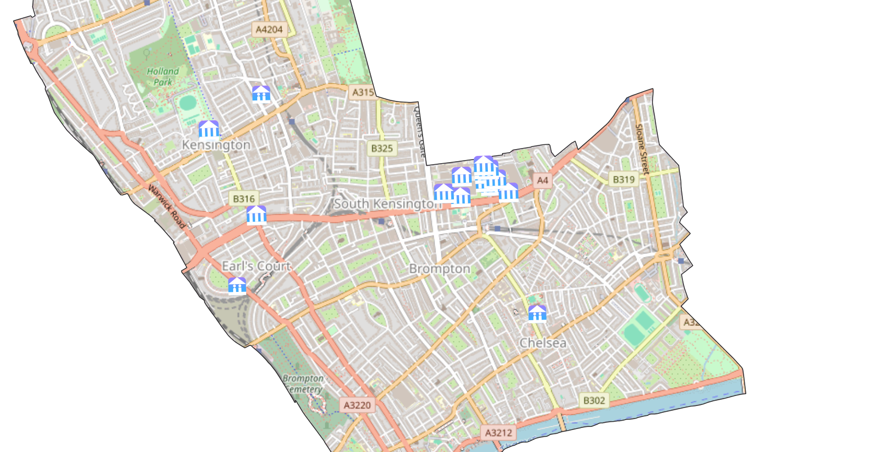

The final workshop in the Inclusive Cartographies Series was held in person at City St George's, University of London on Monday 27 October 2025, from 12:00-17:00. Full slides for the session can be found at the bottom of this page.

The aim of this workshop was to turn design briefs produced over the previous sessions into cartographies. Participants needed to bring their own laptops with QGIS installed.

## Introductions

The day opened with introductions to Carlos Cámara and Timothy Monteath from the University of Warwick; Mirela Reljan-Delaney from City St George's, University of London; and the project as a whole, along with the progression of the workshops to date and an agenda for the day.

Then, Mirela Reljan-Delaney introduced key ideas regarding maps and inequalities:

<embed src="Maps-And-Inequalities.pdf" width="100%" height="500px" />

## Preparation of Groups

Participants were asked to read through all the design briefs. They then formed groups of at least three by gathering near their preferred briefs. Groups then assigned their own roles, including key roles of documenter and QGIS lead, along with optional roles responsible for design or for searching through the OSM wiki and taginfo.

Next, Timothy Monteath and Carlos Cámara helped prepare the groups for the task ahead by delivering a talk on OpenStreetMap and QGIS:

<embed src="OSM-And-QGIS.pdf" width="100%" height="500px" />

The full training materials provided can be found at <https://warwickcim.github.io/Inclusive_Cartographies_Workshop/>.

## Cartography

After lunch, participants turned their attention to designing cartographic styles for their maps.

Aspect of this activity included the identification of OSM queries to use to highlight particular features, and design decisions for these features.

For instance, a group making a map for LGBTQ+ safety selected places with:

-   'lgbtq=primary' or 'lgbtq=welcome' (possible values included 'primary', 'only', 'welcome' and 'no')

-   'amenity=toilets AND unisex=yes'.

The group noted they found no data for:

-   'lgbtq=only\|no'

-   'lgbtq:services=yes'

-   'social_facility:for=lgbtq'

-   'healthcare=counselling AND lgbtq=yes'

The group selected a dark background and minimal labelling to avoid visual clutter. They described another key decision as follows:

> ![](data:image/png;base64,iVBORw0KGgoAAAANSUhEUgAAACEAAAAhCAYAAABX5MJvAAAFzElEQVR4AaRXWWxUVRj+zj2zdZiZDkwLUvZNRZQHNBhJQB4wVUAN4AIhIYLgg2JM1Bh9ECskiDFRiQGaQBRR0ECEoqKCLBWhEdPEgmjZJF2ndINCZzqdzr33+J2WBNJ2bqfl5P/uPef+23f+s0xrYICtADCigP8iEGoAAgpwDTAUjP466oTVwNwXDWONKeWmLCm3paQsjBrG+qiUS+uBYf2N2S8SnPk0JjwgpPxaCPEunV9gwmdZhaVKiDf5LkwZRkmVlMtLATd1GYmRidVZwFMj5TJlGMVMNIs+gwlD11HoRZAcAYK6AIQYz6CbhxrG+yTtRwaN9n1bBYAnabWBsw2CHq5hCoMesRGaayP7aWK+jcAsG55xpGEQgM8Q4g3bMNbqCdDXURjSUY8aIOIyjI20Gg4mCOXbyFmpEysEZ5LMdIXADIXQ4wqRZTYiy23IiKI5PKzKa0Epl+iBExxJ6BMAzobBRsjBCjmrbARnK8gQ0LkMuNUEl8Rg8X13AzkrWJXxnURcLmDFFWDoLcuePUcSq4ARdHnKGARkz7PhHceRFi8fo4mpxEPENGICESAorhwgzGXSFSGVKZbLpS2p6V0cSTDAVJ6CkG+ygu8+BhDEXUQ+obenTv4A+zrFDL7nElMI2rlpF15kg9t1CGx7MhyaMwkp85SER286oQ/cRACPERFCj5mMPUC/WXewYpgOQBNitXysjme80tpRnJB+U9lTHEkIpaRrhBJuff2MovPDBJOZnGBpgxdbz4bwQekQbCwL40i1H7GOm+HG0+5egml9rAEJaMr80Lvc9OpdqYRo9I5RKfiov4fwAI1tEi8dHYb8opF49fgwrDkVwVsnc7HgQB7m/ZCH/64zH4lCLwur4eb+EF5EyUcxQq/iSMJlWeVyEBII0pf7OxqTeP7gcHxRno2rSYmkJWDaAh1Ea8rA8agf074djUNVftgkDBI3fIhLv7jACGnFkUQzcEklcRm8H+MQWP3bUByr8XcFM8NAy2yg6Rng6lygfSy/G7jRIfF2SQ7OXyMLfYKkqka7dZnKtOJI4n6go6NK7VbMe5TJf63mzlO8EJrnA//sBy5/ClS+B1RsAM7tAmpXA9SfbvLil0o/FI+s1YpLqTgupWVAhSMJ6hG7gF2pWsRK6rLQxpKjaQFQxWssxTNoZzEpZ2xz8c0IUPcKCa2DbQZQXOuHFRewmvAz93RCx0qHPknwfrrSGjX217dK2Lrkta8DVpDHX2Fosg4T4ucxMlEBj53sytG8EGhchOqYC+Y5xNovoAh9tD5JaP+kz96OZp6S+qUAZxwwr2NR9Cssrv0S8+v3YlHdN1hS8znyEpU05zloyYdXhZH4S+zMPQ/+mPKzg2REYnAc5V4Tf7rbHkTQvIEnGr7HmPZKuMnLpUxo5KSaML9hH3JZHZhDMCkRbm3+w/4IGbSMSGQdRv1Y0XHEo4Q5MVbO8lf1GjpotmJO40/8HbeQ3RI6NHE5KpBBy4iEKIa5ONFSFA6fjk1ou8g/Key0ofOSUUyyKxKGu323eA5WWsPbFBmR0PZj3kFZfuTgYTcvDj12wmBRffbRQOkpJ5vbdRmTEICa6TqyVoRb2m8P0L2fEm7k5ZYfWBhrqe6uSzfOmIQOsHxdzd+B7Pq9irenHveG67kitTK8o1AUIP2adXPsFwntG07Ft5lZdovud4fNaMHcKxvmrG+o765zGtPNSd1TF/fEzkhp/t5Tw/XymRWRQO3m3nRO3/pNYtO+Hc2WP7mPK3LziuwKrwTfbnvnv3E0stcv6TcJHT01orXIctv8D1CPuqAMu8qQ6sc9e/ZkdCy7vLqeAyKxZdeWa2pQe4HqitH5VC4cC7lryzoH/XwMiITOsbFkw3e2xz6p+5qMFUh8UlC83fH4atveMGASOpgF9TH3Qtzyqq2fnfjwtP6WFg6KOyKRUuKE5caeJNR6hxx9qu6IROGZgoao/9rLhWUF+je8z2TpDP4HAAD//6OuNxwAAAAGSURBVAMARy/oW+mu+68AAAAASUVORK5CYII=)icon is used in combination with conventional symbols (for example, coffee mug for a café) to indicate places that are tagged as primary LGBTQ amenities. This layer can be turned off when the map is being used in areas where the community is stigmatised so that the purpose of the map is not immediately evident. When the map is used in combination with other maps that indicate similar facilities, the primary LGBTQ layer can be turned on for distinction between dedicated spots.

Meanwhile, a group making a map for women and children's safety selected the following features:

-   'amenity=police'

-   'amenity=toilets AND female=yes'

-   'amenity=toilets AND vending=feminine_hygiene'

-   'emergency=phone'

The group noted they found no data for:

-   'community_centre:for=women OR community_center:for=girl' \[*sic*\]

-   'amenity=social_facility AND social_facility=shelter'

-   'amenity=vending_machine AND vending=female_hygiene'

-   'harassment_prevention=\*'

This final query was pointed out as a relatively recent measure. The group raised concerns around the utility of including police stations, giving the negative lived experiences with police of women, especially women of colour. They also discussed merging their map with ones highlighting road safety and childcare concerns.

Finally, another group produced a map of London as a free city, based on the following brief:

<embed src="free-city-design-brief.pdf" width="100%" height="500px" />

The group decided on the following icons and put them to use as seen below in a sample from their map:

 

## Discussion and Evaluation

At the end of the cartography session, participants spent half an hour discussing what they thought and had learnt about maps and OSM, available vs unavailable map features, map design and design principles, and the importance of equitable maps. As part of the workshop evaluation, they also completed a short survey.

## Slides

<embed src="2025-10-27-slides.pdf" width="100%" height="500px" />
